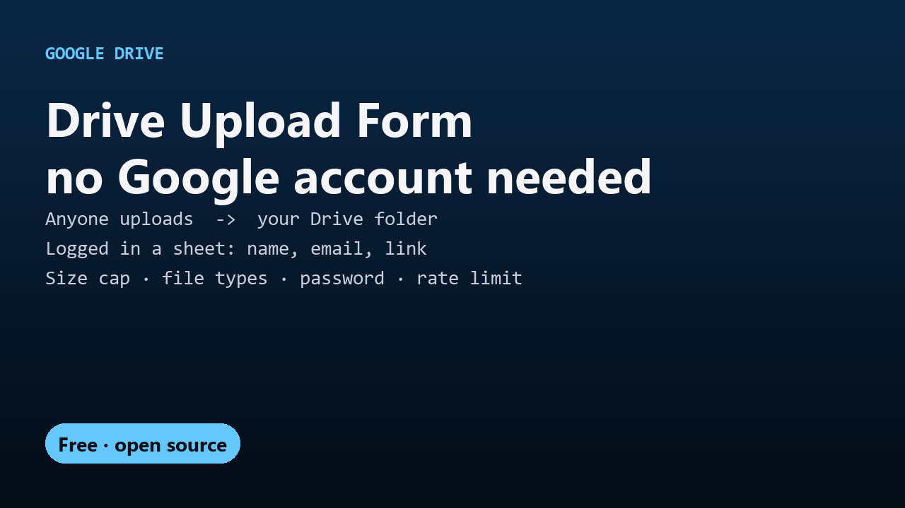

# Free Drive Upload Form

Let anyone upload files to a folder in your Google Drive without a Google account, with every upload logged in a sheet. Free, open-source Apps Script.

## Guides

- [How to let people upload files to your Google Drive without a Google account](upload-files-to-google-drive-without-sign-in.html)
- [A free Formfacade file-upload alternative](formfacade-file-upload-alternative.html)

## Get it

The script and full instructions are on GitHub: [DecodedXR/drive-upload-form](https://github.com/DecodedXR/drive-upload-form). It's MIT licensed and free.
